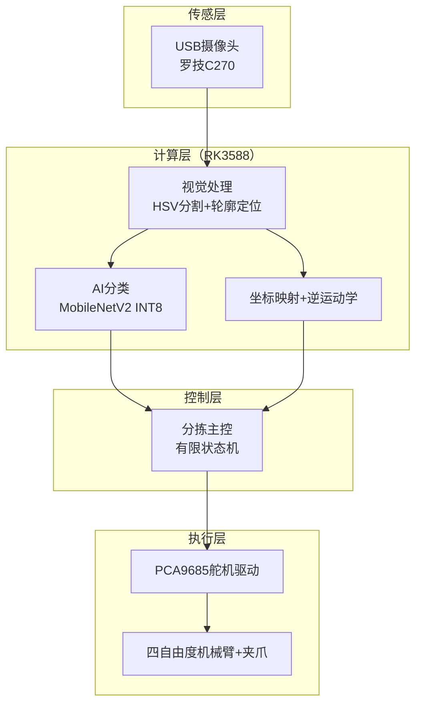
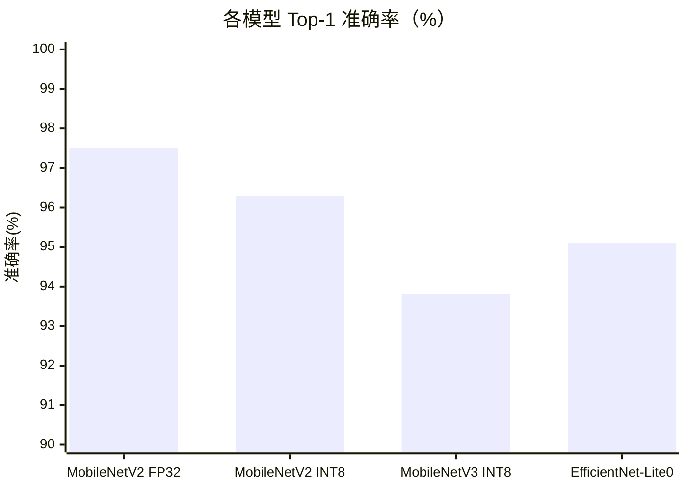
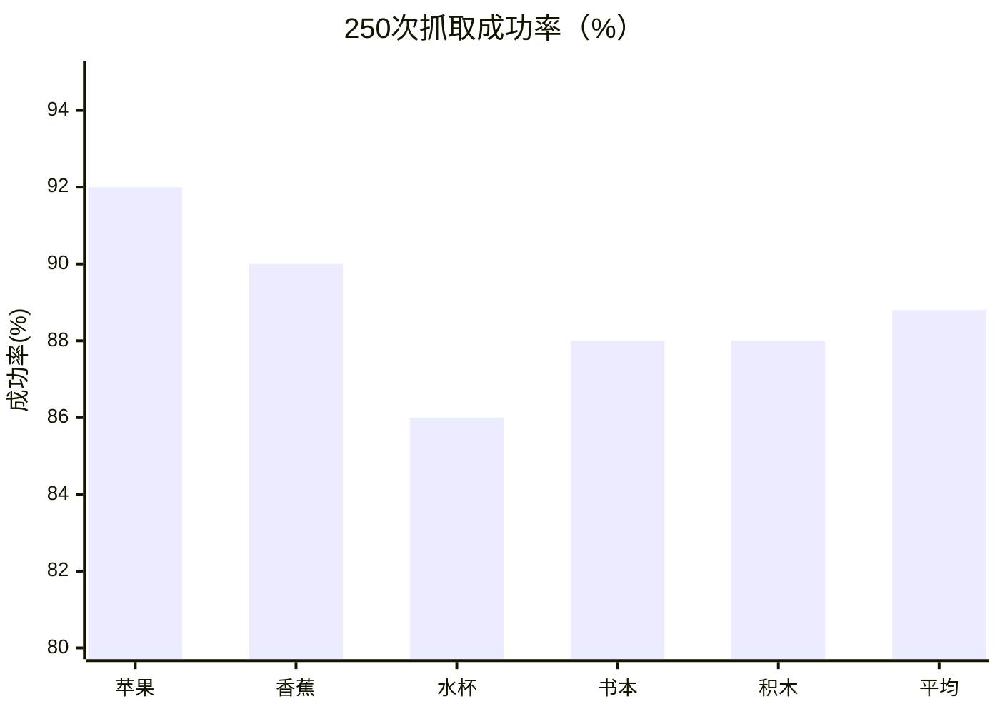
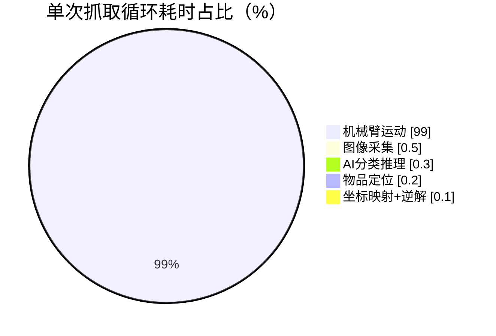
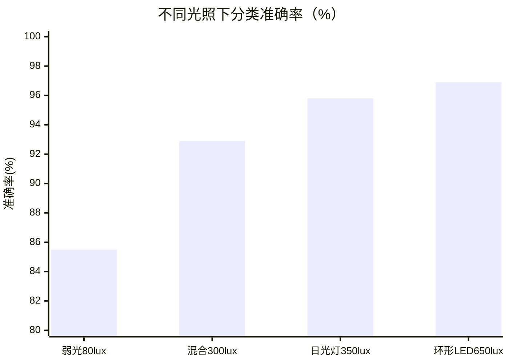
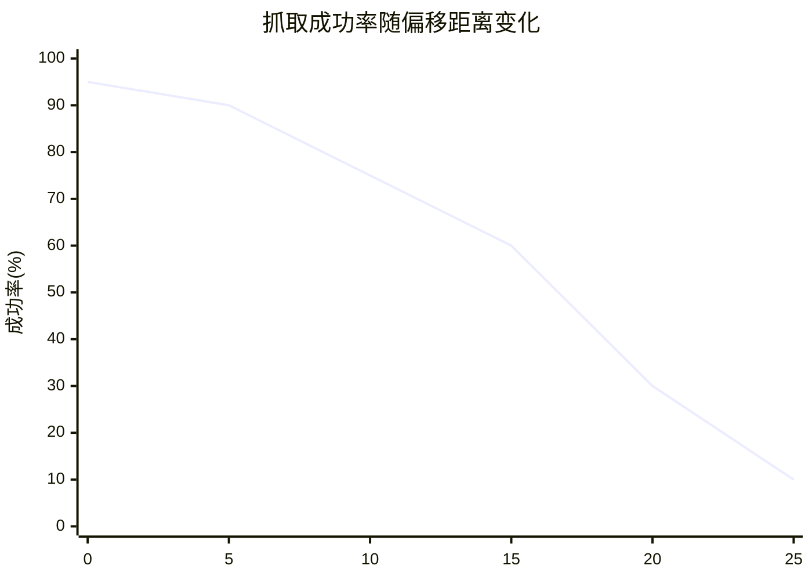

# 嵌入式AI视觉机械臂智能分拣系统

> 2026 开源行业解决方案创新赛 · 开源智能硬件解决方案

针对人工分拣效率低、劳动强度大、成本高，以及工业级视觉分拣设备售价高昂（单套 5~30 万元）
难以向教学与小型产线推广的痛点，本作品设计并实现了一套基于嵌入式 AI 视觉的低成本机械臂智能分拣系统：
以瑞芯微 RK3588 为核心计算单元，集成 USB 摄像头与 PCA9685 驱动的四自由度机械臂，
采用 MobileNetV2 轻量级网络（TensorFlow Lite INT8 全整数量化）实现实时分类，结合 HSV 定位与
四点透视变换完成像素—世界坐标映射，用几何法解析逆运动学规划抓取轨迹。
在 5 类物品任务上分类准确率达 96.3%、综合抓取成功率 88.8%、单次抓取-放置循环 6.8 s，
整机物料成本低于 1500 元。

## 系统架构



> 图1 系统总体架构（据论文重绘）

## 实验结果图表

> 下列图表据论文第 5 章实验数据用 Mermaid 重绘（非原始 PNG 图，数据与论文一致）。



> 图2 各模型分类性能对比（Top-1 准确率：FP32 97.5% / INT8 96.3% / V3 93.8% / EfficientNet-Lite0 95.1%）



> 图3 250次抓取实验结果统计（苹果92.0% / 香蕉90.0% / 水杯86.0% / 书本88.0% / 积木88.0%，平均88.8%）



> 图4 单次抓取循环各阶段耗时占比（机械臂运动占 99.0%）



> 图5 不同光照条件下分类准确率对比（弱光85.5% / 混合92.9% / 日光灯95.8% / 环形LED96.9%）



> 图6 抓取成功率随物品偏移距离变化趋势（0mm 95% → 25mm 10%）

> 说明：图7（模型训练过程曲线）因缺少论文训练历史数据，未在此还原。

> **补充（2026-10-23）**：本目录源码从《软著鉴别材料·源代码》PDF 还原（RK3588 / TensorFlow Lite /
> PCA9685 版本），即论文与软件著作权所述系统的原始实现，详见下方「完整源代码（RK3588）」。
> 注意：它与 RQ-VisionKit 的 RK3506 工具链 Demo 属两个平台，前者为 TFLite INT8 + XNNPACK，
> 后者为 NCNN + RT-Thread。

## 当前状态（降级为「分类识别 + 结果显示」）

按任务书 T2.5 的降级条款，本 Demo 已裁剪为**分类识别 + 结果显示**，不做机械臂抓取：

- **论文权重未找回**：论文的五分类模型（TFLite INT8）真实权重未能复现，只有随机权重版，
  无法演示「识别 5 类物品」的真实分类效果。
- **机械臂硬件未到位**：HSV 定位、透视变换、逆运动学、舵机控制依赖真实机械臂 + 摄像头 + 舵机。
- 因此用**现成有效**的 NEU-DET 六分类 MobileNetV2（accuracy 83.61%）替代演示，证明工具链
  **不止适配检测模型（YOLOX），也能适配分类模型（softmax 输出）**——这是「自定义模型导入」
  能力的关键证据。

## 已落地能力（T2.5）

M4 运行时新增 `task=classify` 分支，支持分类模型：

- 预处理：`resize → BGR2RGB → NCHW float32`，mean/norm 由 ncnn 层完成（`mean=127.5, norm=1/127.5`）
- 后处理：模型输出已含 softmax（`Dense(softmax)`），直接取概率降序返回 top-k
- 经 M3 部署控制台下发（`/deploy`）+ 结果看板（`/deploy/infer` 返回类别 + 概率）

验证结果（PC 仿真）：`crazing` 缺陷图 → top-1 `crazing`（score 0.9975），单帧 9.0ms。
详见 [docs/baselines.md](../docs/baselines.md) 的 T2.5 记录。

## 完整源代码（RK3588）

以下为论文/软著所述「嵌入式AI视觉机械臂智能分拣系统」的完整源码，从软著 PDF 还原：

| 文件 | 说明 |
| --- | --- |
| `main.py` | 系统主程序入口（CLI、标定、单次/自动分拣、性能测试） |
| `sorting_controller.py` | 分拣主控编排（有限状态机 + 统计） |
| `vision.py` | 视觉处理（HSV 背景分割、轮廓定位） |
| `classifier.py` | MobileNetV2 INT8 分类推理（TFLite） |
| `ik_solver.py` | 四自由度机械臂几何法逆运动学 |
| `servo_controller.py` | 舵机控制（重构） |
| `config.py` | 系统配置（重构） |
| `calibration.py` | 相机标定 / 四点透视变换（重构） |
| `hal.py` | 硬件抽象层：摄像头 + PCA9685（重构） |
| `logger.py` | 日志管理（单例） |
| `utils.py` | 通用工具（数学/坐标/图像/计时/线程安全） |
| `train.py` | 模型训练 + INT8 量化 + 数据采集 |
| `setup.sh` | 香橙派5 一键部署脚本 |
| `requirements.txt` | Python 运行依赖 |

> 重构说明：`config.py`、`servo_controller.py`、`calibration.py`、`hal.py` 四个模块因处于软著 PDF 的
> 「前30页+后30页」之间的被截断段而缺失，已**依据《软著设计说明书》接口描述 + 现有代码调用点重构**
> （非原始代码，各文件头已注明重构依据）。完整原始实现如有需要可向作者索取。

## 目录内容

```
sorting_arm/
├── main.py / sorting_controller.py / vision.py   # RK3588 分拣系统源码（软著PDF还原）
├── classifier.py / ik_solver.py / servo_controller.py / config.py
├── calibration.py / hal.py / logger.py / utils.py / train.py
├── setup.sh / requirements.txt
└── model/report.json   # T1.6 论文 MobileNetV2（五分类）转换报告（onnxsim→pnnx→ncnnoptimize）
```

> 说明：`report.json` 记录的 `paper_mobilenetv2.onnx` 为随机权重版（论文真实权重未找回），
> 仅用于验证 Keras→ONNX→NCNN 转换链路，不用于实际识别。模型本体（.param/.bin）不入库。
